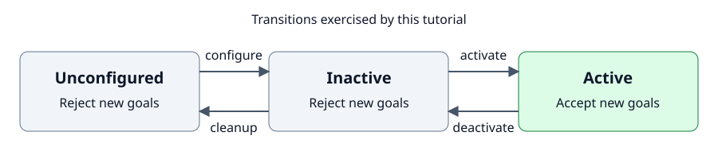

# Tutorial 4: build a lifecycle action server in C++ and Python

Define a Fibonacci action once, generate a lifecycle base for either language, then add the application behavior.

> **Shared contract → Generated base → Lifecycle subclass → Conform**

Choose C++ or Python in any language tab.
The browser remembers the selection for the other grouped tabs on this page.

The handwritten subclasses keep the calculation and callback structure familiar from the official
[`examples_rclcpp_minimal_action_server`](https://github.com/ros2/examples/tree/rolling/rclcpp/actions/minimal_action_server)
and
[`examples_rclpy_minimal_action_server`](https://github.com/ros2/examples/tree/rolling/rclpy/actions/minimal_action_server).
No existing server is required; this tutorial starts from the interface contract.

## 1. Define one public action contract

Begin with the language-neutral public interface:

```{literalinclude} ../../../examples/nodl_tutorials/lifecycle_action/nodl/fibonacci.nodl.yaml
:language: yaml
```

Only this file is public and registered.
The shared lifecycle provider supplies both languages' base-class metadata and lifecycle interfaces.
It deliberately leaves the algorithm, feedback, cancellation, and inactive-state policy to the application.
The relative `fibonacci` name follows the upstream examples and remains namespace- and remap-friendly.
In the root namespace it appears as `/fibonacci` on the ROS graph.

## 2. Register the contract and generate a base

Choose one package: C++ or Python.
Each has its own complete `CMakeLists.txt` and builds independently using the shared `fibonacci.nodl.yaml`.
Its generator call both creates the base and registers the contract as the package's `fibonacci` resource.

::::{tabs}
:::{group-tab} C++

**`cpp/CMakeLists.txt`** — the C++ build path, with its NoDL additions highlighted:

```{literalinclude} ../../../examples/nodl_tutorials/lifecycle_action/cpp/CMakeLists.txt
:language: cmake
:linenos:
:emphasize-lines: 7-8,10-13,16
```

This generates a lifecycle node with `on_fibonacci_goal`, `on_fibonacci_cancel`, and `on_fibonacci_accepted`
callbacks.

:::{note}
:collapsible: closed
:title: Generated C++ base

```{literalinclude} ../../../examples/nodl_tutorials/lifecycle_action/test/expected/generated_cpp.txt
:language: cpp
```

:::

:::
:::{group-tab} Python

**`python/CMakeLists.txt`** — the Python build path, with its NoDL additions highlighted:

```{literalinclude} ../../../examples/nodl_tutorials/lifecycle_action/python/CMakeLists.txt
:language: cmake
:linenos:
:emphasize-lines: 7-8,10-13
```

This generates a lifecycle node with `on_fibonacci_goal`, `on_fibonacci_cancel`, and `execute_fibonacci` callbacks.

:::{note}
:collapsible: closed
:title: Generated Python base

```{literalinclude} ../../../examples/nodl_tutorials/lifecycle_action/test/expected/generated_python.txt
:language: python
```

:::

:::
::::

## 3. Implement behavior and lifecycle policy

Each complete server fits in one short source file:
{download}`C++ source <../../../examples/nodl_tutorials/lifecycle_action/cpp/fibonacci_action_server.cpp>` or
{download}`Python source <../../../examples/nodl_tutorials/lifecycle_action/python/fibonacci_action_server.py>`.
The excerpts below explain its three responsibilities, with line numbers matching the source.

### Gate goals with lifecycle state

Start inactive, open the gate only after activation succeeds, and close it before deactivation:

::::{tabs}
:::{group-tab} C++

```{literalinclude} ../../../examples/nodl_tutorials/lifecycle_action/cpp/fibonacci_action_server.cpp
:language: cpp
:lines: 87
:lineno-match:
```

```{literalinclude} ../../../examples/nodl_tutorials/lifecycle_action/cpp/fibonacci_action_server.cpp
:language: cpp
:lines: 25-36
:lineno-match:
```

:::
:::{group-tab} Python

```{literalinclude} ../../../examples/nodl_tutorials/lifecycle_action/python/fibonacci_action_server.py
:language: python
:lines: 19-30
:lineno-match:
```

:::
::::

### Decide whether to accept a goal or cancellation

Reject a goal while inactive and accept cancellation requests.
Limit the order to 0–46 so the sequence fits the action's 32-bit integers:

::::{tabs}
:::{group-tab} C++

```{literalinclude} ../../../examples/nodl_tutorials/lifecycle_action/cpp/fibonacci_action_server.cpp
:language: cpp
:start-at: rclcpp_action::GoalResponse on_fibonacci_goal(
:end-before: void on_fibonacci_accepted
:lineno-match:
```

:::
:::{group-tab} Python

```{literalinclude} ../../../examples/nodl_tutorials/lifecycle_action/python/fibonacci_action_server.py
:language: python
:start-at: def on_fibonacci_goal
:end-before: def execute_fibonacci
:lineno-match:
```

:::
::::

### Execute the accepted goal

Calculate the sequence, publish feedback, observe cancellation, and return the result:

::::{tabs}
:::{group-tab} C++

```{literalinclude} ../../../examples/nodl_tutorials/lifecycle_action/cpp/fibonacci_action_server.cpp
:language: cpp
:start-at: void on_fibonacci_accepted
:end-before: std::atomic_bool active_
:lineno-match:
```

:::
:::{group-tab} Python

```{literalinclude} ../../../examples/nodl_tutorials/lifecycle_action/python/fibonacci_action_server.py
:language: python
:start-at: def execute_fibonacci
:end-before: def main
:lineno-match:
```

:::
::::

The calculation, feedback, result, cancellation decision, and lifecycle gate all stay in the subclasses.

## 4. Understand the lifecycle boundary

The [standard ROS 2 lifecycle](https://design.ros2.org/articles/node_lifecycle.html) separates setup from operation.
A node starts **unconfigured**; `configure` prepares its resources and leaves it **inactive**.
`activate` enables application work, `deactivate` returns it to inactive, and `cleanup` releases resources and returns
it to unconfigured.
The application decides what each transition means for its own interfaces.



For this server, that standard lifecycle and the application policy divide as follows:

| Generated base/provider supplies | Handwritten subclass supplies |
| --- | --- |
| `LifecycleNode` inheritance, state machine, transition services, and default transition callbacks | The decision that new goals are accepted only while active |
| Construction and naming of the `/fibonacci` action server | Goal validation, Fibonacci calculation, feedback, result, and cancellation behavior |
| The language-specific callback surface and action message plumbing | Activation and deactivation overrides that maintain the active gate |

A ROS action server is not automatically lifecycle-managed.
The generated action server remains discoverable while the node is unconfigured or inactive.
Both subclasses start with a closed gate, open it after successful activation, and close it before deactivation.
Deactivation prevents new goals; an accepted goal continues until it succeeds or a client cancels it.
Cleanup needs no extra policy callback because it is reached from the already-inactive state.

## 5. Run the lifecycle and action

Build and run the selected package.
Run one implementation at a time.
Both commands use the standard `__node` remap to give it the same node name, `/fibonacci_action_server`:

::::{tabs}
:::{group-tab} C++

```bash
colcon build --packages-up-to nodl_tutorial_lifecycle_action_cpp
source install/setup.bash
ros2 run nodl_tutorial_lifecycle_action_cpp fibonacci_action_server_cpp \
  --ros-args -r __node:=fibonacci_action_server
```

:::
:::{group-tab} Python

```bash
colcon build --packages-up-to nodl_tutorial_lifecycle_action_py
source install/setup.bash
ros2 run nodl_tutorial_lifecycle_action_py fibonacci_action_server_py \
  --ros-args -r __node:=fibonacci_action_server
```

:::
::::

In a second terminal, exercise the lifecycle with the same commands for either language:

```bash
source install/setup.bash
ros2 lifecycle get /fibonacci_action_server
ros2 lifecycle set /fibonacci_action_server configure
ros2 lifecycle set /fibonacci_action_server activate
```

Send a goal while active and display feedback:

```bash
ros2 action send_goal --feedback /fibonacci example_interfaces/action/Fibonacci "{order: 5}"
```

Then close the active gate and return to the unconfigured state:

```bash
ros2 lifecycle set /fibonacci_action_server deactivate
ros2 lifecycle set /fibonacci_action_server cleanup
```

A goal sent before activation or after deactivation is rejected by the subclass policy.
The fixture tests also cancel an in-progress goal and verify its canceled result.

Finally, compare the running server with the same contract in any lifecycle state.
It describes the action and the shared provider's observable lifecycle endpoints:

```bash
ros2 nodl conform /fibonacci_action_server \
  --file examples/nodl_tutorials/lifecycle_action/nodl/fibonacci.nodl.yaml
```

The result is `/fibonacci_action_server: conforms`.

The CI fixture uses only lifecycle services and an action client.
It forces the same node name with `--ros-args -r __node:=fibonacci_action_server` and tests each executable in turn.
It tests registration, generated inheritance, transitions, inactive rejection, feedback, results, cancellation, and
conformance without RViz, Gazebo, or Nav2.
